<!--
  Duo · profile README
  Two things draw this page: banner/hero.svg and banner/hero-light.svg (a
  query, drawn as a query), and the text below. Everything else is done by
  GitHub. The table between the MERGED markers is rewritten every day by
  .github/workflows/update-profile.yml — do not edit it by hand.
-->

  <picture>
    <source media="(prefers-color-scheme: dark)" srcset="https://raw.githubusercontent.com/Duo-ee/Duo-ee/main/banner/hero.svg">
    <source media="(prefers-color-scheme: light)" srcset="https://raw.githubusercontent.com/Duo-ee/Duo-ee/main/banner/hero-light.svg">
    
  </picture>

## 01 · what I work on

The unglamorous half of software: the part that reads other people's SQL and has
to be right. Most of it is dialect grammar — teaching a parser to accept real
syntax it currently rejects, without turning permissive about everything else.

`sqlfluff` · `sphinx` · `aquascope` · parsers · database internals

## 02 · selected work

**[sqlfluff](https://github.com/sqlfluff/sqlfluff)** — dialect grammars
Redshift `SHOW` statements and dynamic data-masking policies, Trino `TRUNCATE
TABLE`, Databricks magic-cell newlines in LT01. Each fix ships fixtures proving
the new syntax parses *and* that the surrounding rules did not get looser. Also:
alignment on a 200-column query went from **32s to 1.1s**
([#8869](https://github.com/sqlfluff/sqlfluff/pull/8869)).

**[aquascope](https://github.com/Rekin226/aquascope)** — a public hydrology archive
Catalog and mirror now state their size the same way, Sen's slope measures
against calendar years instead of row positions, GloFAS requests go to the
endpoint that actually serves them, near-dry basins stay out of "rivers much
above normal", and a station's founding year no longer passes for the start of
its record ([#699](https://github.com/Rekin226/aquascope/issues/699)).

**[fd](https://github.com/sharkdp/fd)** — Windows paths
Verbatim paths stay absolute under `--absolute-path`
([#2208](https://github.com/sharkdp/fd/pull/2208)).

## 03 · merged so far

<!-- MERGED:START -->
| Repository | PR | Change |
|:--|:--|:--|
| [Rekin226/aquascope](https://github.com/Rekin226/aquascope) | [#676](https://github.com/Rekin226/aquascope/pull/676) | Reconnaissance: a quality half on SiteContext, read from a local Arch... |
| [Rekin226/aquascope](https://github.com/Rekin226/aquascope) | [#684](https://github.com/Rekin226/aquascope/pull/684) | Report partial station harvests and a station-count drop (#289) |
| [Rekin226/aquascope](https://github.com/Rekin226/aquascope) | [#672](https://github.com/Rekin226/aquascope/pull/672) | copernicus: send GloFAS requests to the EWDS |
| [sharkdp/fd](https://github.com/sharkdp/fd) | [#2208](https://github.com/sharkdp/fd/pull/2208) | fix: keep verbatim Windows paths absolute in --absolute-path |
| [Rekin226/aquascope](https://github.com/Rekin226/aquascope) | [#675](https://github.com/Rekin226/aquascope/pull/675) | Scout: set aside near-dry areas in the river status findings (#638) |
| [Rekin226/aquascope](https://github.com/Rekin226/aquascope) | [#671](https://github.com/Rekin226/aquascope/pull/671) | Sen's slope: a missing year is a gap in time (#668) |
| [Rekin226/aquascope](https://github.com/Rekin226/aquascope) | [#689](https://github.com/Rekin226/aquascope/pull/689) | fix(gym): bind refusal reviews to evidence and clarify provisional sc... |
| [Rekin226/aquascope](https://github.com/Rekin226/aquascope) | [#686](https://github.com/Rekin226/aquascope/pull/686) | fix(what-if): keep units on fractional quantities |
<!-- MERGED:END -->

Eight most recent, refreshed nightly by
[`update-profile.yml`](https://github.com/Duo-ee/Duo-ee/blob/main/.github/workflows/update-profile.yml).
Still open and waiting on review:
[#8868](https://github.com/sqlfluff/sqlfluff/pull/8868), a reusable parser
matcher for delimiters that have to sit on their own line (Oracle's `/`), and
[#8873](https://github.com/sqlfluff/sqlfluff/pull/8873), a warm worker runner
that keeps templating out of the hot path of parallel linting.

## 04 · reviews

Seven substantial ones so far, each backed by a local reproduction rather than
an opinion — a Trino `CREATE FUNCTION` that threw an internal `RuntimeError`
before the PR, 93 RF02 cases exercised before and after, and a runtime check
showing that removing a whole-row exemption turns exactly the three intended
cases red:

[#8849](https://github.com/sqlfluff/sqlfluff/pull/8849#pullrequestreview-5643719741) ·
[#8791](https://github.com/sqlfluff/sqlfluff/pull/8791#pullrequestreview-5643739263) ·
[#8871](https://github.com/sqlfluff/sqlfluff/pull/8871#pullrequestreview-5643764745) ·
[#8867](https://github.com/sqlfluff/sqlfluff/pull/8867#pullrequestreview-5643792353) ·
[#8881](https://github.com/sqlfluff/sqlfluff/pull/8881#pullrequestreview-5651612578) ·
[#8886](https://github.com/sqlfluff/sqlfluff/pull/8886#pullrequestreview-5651728838) ·
[#8885](https://github.com/sqlfluff/sqlfluff/pull/8885#pullrequestreview-5651931339)

## 05 · open questions

- How far can a grammar stay permissive before it stops saying no?
- Incremental parsing and caching, so linting a large repo stops re-doing work.
- Query planners: why the same SQL can cost 30× more on one engine than another.
- Compilers. I wrote a C-minus one and liked the front end more than the back.
- The gap between "the test passes" and "the behaviour is still right".

---

**Duo-ee means 对！** · CS, USTC · This README is hand-written; my
contributions use AI assistance, and every PR I open says so.
