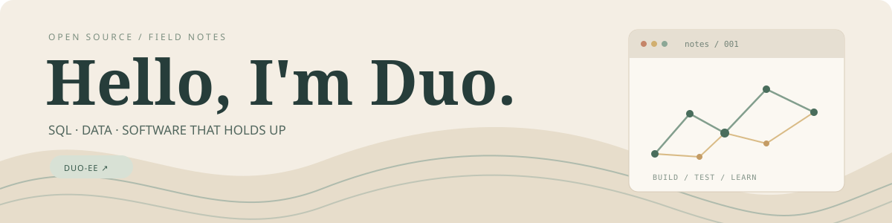

<!-- The merged PR table is updated by scripts/update_profile.py. -->

  

### Hi, I'm Duo. 对！

I contribute to open-source projects, mostly around **SQL tooling, parsers and data**.
I like tracing a surprising result back to its cause, making a focused change,
and leaving a test that explains why it matters.

`SQL` &nbsp; `Python` &nbsp; `parsers` &nbsp; `data tools` &nbsp; `open source`

---

### Selected contributions

<table>
<tr>
<td width="33%" valign="top">
<strong>01 / SQLFLUFF</strong>  
<strong>Making SQL tooling more precise</strong>  
Dialect grammar, parsing and performance work across real-world SQL. An alignment improvement reduced a 200-column query from 33.6s to 1.37s in the reported benchmark.  
<a href="https://github.com/sqlfluff/sqlfluff/pull/8869">Explore the change →</a>
</td>
<td width="33%" valign="top">
<strong>02 / AQUASCOPE</strong>  
<strong>Making water data more useful</strong>  
Contributions to archive quality and hydrology: handling partial station harvests and measuring trends across gaps in calendar time.  
<a href="https://github.com/Rekin226/aquascope/pull/684">Station harvests →</a> · <a href="https://github.com/Rekin226/aquascope/pull/671">Trend analysis →</a>
</td>
<td width="33%" valign="top">
<strong>03 / FD</strong>  
<strong>Getting the details right</strong>  
Fixed an edge case where Windows verbatim paths did not remain absolute under <code>--absolute-path</code>.  
<a href="https://github.com/sharkdp/fd/pull/2208">See the pull request →</a>
</td>
</tr>
</table>

### Recent merged work

A small, automatically refreshed window into the work. [See all merged pull requests →](https://github.com/pulls?q=is%3Apr+is%3Amerged+author%3ADuo-ee)

<b>Open the latest eight contributions</b>

 

<!-- MERGED:START -->
| Repository | PR | Change |
|:--|:--|:--|
| [Rekin226/aquascope](https://github.com/Rekin226/aquascope) | [#706](https://github.com/Rekin226/aquascope/pull/706) | explorer: name a reach's card after the river, not a nearby pond (#637) |
| [Rekin226/aquascope](https://github.com/Rekin226/aquascope) | [#703](https://github.com/Rekin226/aquascope/pull/703) | archive: take a station span from the record, not the founding year |
| [Rekin226/aquascope](https://github.com/Rekin226/aquascope) | [#701](https://github.com/Rekin226/aquascope/pull/701) | gym: check a required method against the full reconnaissance (#700) |
| [Rekin226/aquascope](https://github.com/Rekin226/aquascope) | [#698](https://github.com/Rekin226/aquascope/pull/698) | gym: a snow-fed Carpathian reference plan for winter supply (#442) |
| [Rekin226/aquascope](https://github.com/Rekin226/aquascope) | [#695](https://github.com/Rekin226/aquascope/pull/695) | gym: score a faithful potomac-supply report (#441) |
| [Rekin226/aquascope](https://github.com/Rekin226/aquascope) | [#696](https://github.com/Rekin226/aquascope/pull/696) | ci: a capped harvest never publishes the catalogue (#692) |
| [Rekin226/aquascope](https://github.com/Rekin226/aquascope) | [#694](https://github.com/Rekin226/aquascope/pull/694) | docs: state the Archive's counts from the 2026-10-26 harvest |
| [Rekin226/aquascope](https://github.com/Rekin226/aquascope) | [#707](https://github.com/Rekin226/aquascope/pull/707) | ci: use CPU-only PyTorch on Linux runners |
<!-- MERGED:END -->

### Things I'm curious about

How parsers balance flexibility and precision · making developer tools faster ·
what data can and cannot tell us · the difference between passing a test and
getting the behavior right.

---

**Duo-ee** means 对！ · Open-source contributions with AI assistance.
