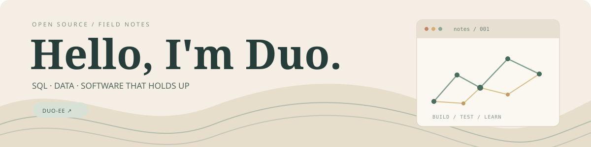

<!-- The merged PR table is updated by scripts/update_profile.py. -->

  

### Hi, I'm Duo. 对！

I contribute to open-source projects, mostly around **SQL tooling, parsers and data**.
I like tracing a surprising result back to its cause, making a focused change,
and leaving a test that explains why it matters.

`SQL` &nbsp; `Python` &nbsp; `parsers` &nbsp; `data tools` &nbsp; `open source`

---

### Selected contributions

<table>
<tr>
<td width="33%" valign="top">
<strong>01 / SQLFLUFF</strong>  
<strong>Making SQL tooling more precise</strong>  
Dialect grammar, parsing and performance work across real-world SQL. An alignment improvement reduced a 200-column query from 33.6s to 1.37s in the reported benchmark.  
<a href="https://github.com/sqlfluff/sqlfluff/pull/8869">Explore the change →</a>
</td>
<td width="33%" valign="top">
<strong>02 / AQUASCOPE</strong>  
<strong>Making water data more useful</strong>  
Contributions to archive quality and hydrology: handling partial station harvests and measuring trends across gaps in calendar time.  
<a href="https://github.com/Rekin226/aquascope/pull/684">Station harvests →</a> · <a href="https://github.com/Rekin226/aquascope/pull/671">Trend analysis →</a>
</td>
<td width="33%" valign="top">
<strong>03 / FD</strong>  
<strong>Getting the details right</strong>  
Fixed an edge case where Windows verbatim paths did not remain absolute under <code>--absolute-path</code>.  
<a href="https://github.com/sharkdp/fd/pull/2208">See the pull request →</a>
</td>
</tr>
</table>

### Recent merged work

A small, automatically refreshed window into the work. [See all merged pull requests →](https://github.com/pulls?q=is%3Apr+is%3Amerged+author%3ADuo-ee)

<b>Open the latest eight contributions</b>

 

<!-- MERGED:START -->
| Repository | PR | Change |
|:--|:--|:--|
| [Rekin226/aquascope](https://github.com/Rekin226/aquascope) | [#818](https://github.com/Rekin226/aquascope/pull/818) | Exclude infinite flows from forecast verification |
| [Rekin226/aquascope](https://github.com/Rekin226/aquascope) | [#817](https://github.com/Rekin226/aquascope/pull/817) | Use the best-sampled gauge on the river forecast card |
| [sqlfluff/sqlfluff](https://github.com/sqlfluff/sqlfluff) | [#8868](https://github.com/sqlfluff/sqlfluff/pull/8868) | fix(oracle): parse division inside CREATE VIEW bodies |
| [Rekin226/aquascope](https://github.com/Rekin226/aquascope) | [#816](https://github.com/Rekin226/aquascope/pull/816) | Screen reservoir flood attenuation from the flood-risk playbook |
| [sqlfluff/sqlfluff](https://github.com/sqlfluff/sqlfluff) | [#9146](https://github.com/sqlfluff/sqlfluff/pull/9146) | feat(bigquery): add BQ01 to forbid WITH expressions |
| [Rekin226/aquascope](https://github.com/Rekin226/aquascope) | [#813](https://github.com/Rekin226/aquascope/pull/813) | Run Flood it as a screening inundation study (#787) |
| [sqlfluff/sqlfluff](https://github.com/sqlfluff/sqlfluff) | [#8869](https://github.com/sqlfluff/sqlfluff/pull/8869) | perf(reflow): find alignment siblings in a single walk |
| [Rekin226/aquascope](https://github.com/Rekin226/aquascope) | [#807](https://github.com/Rekin226/aquascope/pull/807) | Export the routed flood hydrograph from Study |
<!-- MERGED:END -->

### Things I'm curious about

How parsers balance flexibility and precision · making developer tools faster ·
what data can and cannot tell us · the difference between passing a test and
getting the behavior right.

---

**Duo-ee** means 对！ · Open-source contributions with AI assistance.
